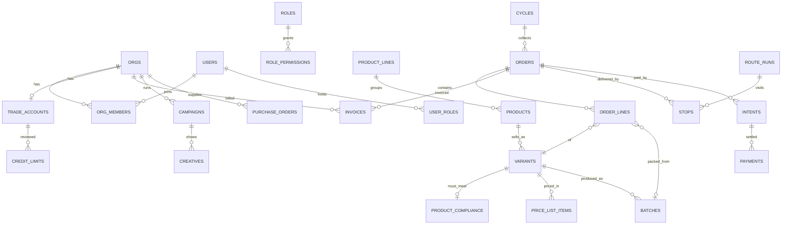

# Data model
Ten schemas, one per bounded context. See `db/migrations`. Money in cents, UTC times, UUID keys.

| Schema | Main tables |
|---|---|
| identity | orgs, users, roles, permissions, role_permissions, user_roles, org_members, api_keys, elevation_requests |
| catalog | product_lines, categories, products, variants, product_compliance, media, price_lists, price_list_items, bundles, bundle_items, merch_sections, merch_items |
| inventory | batches, stock_levels, stock_movements, temperature_logs, recalls |
| sales | cycles, cycle_capacity, orders, order_lines, order_events, standing_orders, standing_order_lines, reservations, quotes, subscriptions, promotions, gift_cards, reviews |
| accounts | trade_accounts, credit_applications, documents, bureau_reports, credit_limits, credit_events, sureties, invoices, invoice_lines, allocations, collection_actions, disputes |
| logistics | zones, vehicles, drivers, routes, slots, route_runs, stops, deliveries, proof_of_delivery, sync_events |
| payments | intents, payments, refunds, provider_events, settlements, settlement_lines, payouts, escrow_transactions |
| ads | advertisers, slots, campaigns, creatives, wallet_ledger, impressions (partitioned), clicks |
| partners | purchase_orders, purchase_order_lines, slots, documents |
| audit | audit_log, data_access_log (append-only) |

## Row-level security

The gateway sets `app.staff`, `app.org_id` and `app.user_id` per request after RBAC. Policies in `0010_row_level_security.sql` and `0011_rls_personal_data.sql` scope each row to its owner; with none of the settings present the default is deny.

- A superuser or table owner bypasses RLS entirely, so the application connects as a `NOSUPERUSER NOBYPASSRLS` role. See `db/README.md`.
- A policy with only `USING` also governs `INSERT` and `UPDATE`.
- Child tables inherit the parent's visibility by testing the parent row (which is itself subject to RLS), so a line is visible exactly when its order or invoice is.

`db/tests/rls.sql` is the source of truth and runs in the CI `db` job. It covers orders, invoices and campaigns (the acceptance criteria) plus the tables added in 0011: order lines and events, reservations, subscriptions, quotes, reviews, trade accounts, credit applications, documents, bureau reports, credit limits, credit events, sureties, invoice lines, allocations, collection actions, disputes, advertisers, wallet ledger, creatives, partner documents and slots, purchase order lines, payouts, payment intents, payments, refunds, stops, deliveries and proof of delivery.
